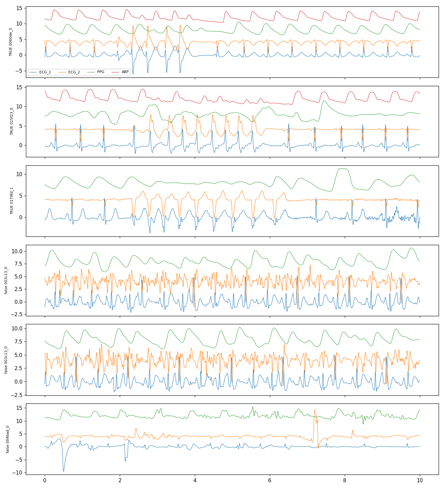
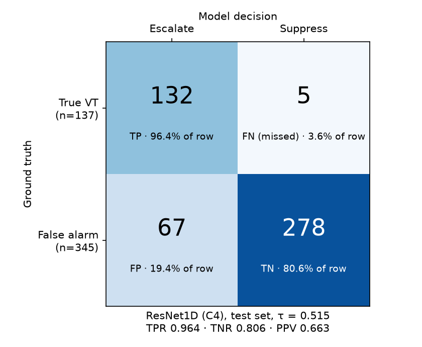

# ICU VT False-Alarm Reduction


**AI-Based Continuous Patient Monitoring Dashboard.** It classifies ventricular tachycardia (VT)
alarms from ICU bedside monitors as true or false, to cut alarm fatigue while rarely missing a true
alarm.

> Everything shown in the dashboard is **simulated real-time (replayed recordings)** from the open
> VTaC dataset. This project does not connect to live bedside monitors, has no clinical validation
> and is **not for clinical use**.

**Contents:** [What it is](#what-it-is) · [Results](#results) · [Run the demo](#run-the-demo) ·
[Limitations](#limitations) · [Layout](#layout) · [Docs](#docs) · [Data and credits](#data-and-credits) ·
[License](#license)

## What it is

- **Data:** [VTaC on PhysioNet](https://physionet.org/content/vtac/1.0/), 5,037 labeled VT alarms,
  each a 6-minute recording at 250 Hz (ECG plus pulse-wave and blood-pressure channels when
  available). The brief gives 28.61% as true alarms.
- **Model:** a small 1D ResNet reads the 10 s of signal around the alarm (8 s before to 2 s after
  the monitor raised it) and outputs the probability that the alarm is real. Channels that are
  absent or unusable are masked, not invented.
- **Decision rule:** escalate if `p >= 0.515`; otherwise suppress. The threshold was chosen on
  validation data only: keep at least 95% of true alarms, then minimise cost where a missed true
  alarm counts as 5 false alarms.
- **Serving:** FastAPI + onnxruntime on CPU replays recordings over a WebSocket; a React dashboard
  draws the waveforms and the verdicts.

**What the model sees.** Six 10 s model-input windows after filtering and scaling (the first three
true and the first three false events in the processed data; the four channels are shifted up and
down only so they do not overlap).
Source: `reports/window_samples.png`, written by `notebooks/01_data_prep.ipynb`.



## Results

Held-out **test set**: 482 alarms (137 true, 345 false), official patient-level split, evaluated
once. Source: `models/model_config.json` (CNN) and `reports/baseline_metrics_off2.0.json` (XGBoost).
Details, validation numbers and ablations: [docs/modeling.md](docs/modeling.md).

| Model | True alarms caught (TPR) | False alarms suppressed (TNR) | Missed true / false escalated | PR-AUC | Challenge Score (95% CI) |
|---|---|---|---|---|---|
| XGBoost, ECG features (B0) | 0.949 (130 of 137) | 0.620 (214 of 345) | 7 / 131 | 0.704 | 0.675 (0.609-0.733) |
| XGBoost, all features (B1) | 0.971 (133 of 137) | 0.603 (208 of 345) | 4 / 137 | 0.742 | 0.685 (0.616-0.746) |
| **ResNet1D, served (C4)** | **0.964 (132 of 137)** | **0.806 (278 of 345)** | **5 / 67** | **0.875** | **0.817 (0.767-0.867)** |

### Confusion matrix (served CNN, test set, τ = 0.515)



| | Predicted: escalate | Predicted: suppress | Total |
|---|---|---|---|
| **Actually true (VT)** | 132 (TP) | 5 (FN, missed) | 137 |
| **Actually false** | 67 (FP) | 278 (TN) | 345 |

- Staff see 199 alarms instead of 482 (59% fewer).
- PPV is 0.663: about 2 in 3 escalated alarms are real, against 0.284 with no model.
- A miss costs 5 false alarms in the Challenge Score, so the 5 misses matter more than the 67
  false escalations.

Regenerate the image with `uv run --with matplotlib python reports/plot_confusion_matrix.py`.

At the served threshold the CNN keeps about the same recall as the best baseline with about half the
false alarms. The 95% intervals come from a patient-level bootstrap and are wide: the test TPR is an
estimate, not a guarantee. All results are one training run (one seed).

**Speed** (`docs/api.md`, `reports/replay_sample_check.json`): scoring one alarm (preprocessing plus
model) on the target laptop (Intel Core i3 M 380) took a median 40.3 ms and a p95 of 80.5 ms over
250 warm calls. Browser frame rate is not measured.

**Replay sample** (25 test alarms, 10 true / 15 false, a demo set and not a performance estimate):
9 of 10 true alarms escalated and 12 of 15 false alarms suppressed.

### A failure case

Alarm `a06fbf_0500` is a true alarm that the model **suppressed**: p(true) = 0.476, just 0.039 below
the threshold. In the dashboard readouts the heart rate and pulse rate agree (about 117-118/min)
until about 297 s and the change only starts in the last few seconds of the scored window. The
dashboard shows this miss on purpose. Why the model scored it 0.476 is not known. See
[docs/modeling.md](docs/modeling.md#failure-cases).

## Run the demo

Prerequisites: Python 3.11, [uv](https://docs.astral.sh/uv/), Node 20.19+, pnpm. The model
(`models/model.onnx`, ~2 MB, and `models/model_config.json`) is **in git**. The replay sample is
not; copy it from Google Drive (`MyDrive/vtac/`): `replay/replay_sample.npz`,
`replay/replay_index.json` -> `data/sample/`.

```bash
uv venv --python 3.11 .venv && source .venv/bin/activate
uv pip install -e ".[backend,dev]"
VTAC_MODEL_MODE=onnx uv run uvicorn backend.app.main:app       # terminal 1
cd frontend && pnpm install && pnpm dev                          # terminal 2 -> http://localhost:5173
```

Without the model, `VTAC_MODEL_MODE=mock` runs the UI with dummy hashed scores (not a model), and
without the sample the backend falls back to generated synthetic alarms. Follow
[docs/demo.md](docs/demo.md) for a four-alarm walk-through.

Checks: `uv run pytest` (61 passed, 4 skipped on 2026-10-18), `uv run ruff check . && uv run ruff
format --check .`, and in `frontend/`: `pnpm typecheck && pnpm lint && pnpm test` (231 tests passed
on 2026-10-18). On this old laptop one test (`TransportBar`, "has labelled prev / next buttons...")
sometimes exceeds Vitest's default 5 s timeout when the machine is busy: it failed in 2 of 6 full runs on
2026-10-18 and passed on rerun. It is a slow-machine timeout, not an assertion failure; the config was
not changed.

## Limitations

- **Replay only.** Recorded data streamed as if live. No monitor integration, no clinical
  validation, not a medical device.
- **One dataset, one split, one seed.** No external validation and no repeat runs; the
  Challenge Score interval on test is 0.767-0.867.
- **The window offset is a guess.** The model scores the 10 s ending 2.0 s after onset. The official
  benchmark window ends at onset; that comparison (W0) was never run, so results are not directly
  comparable with published numbers.
- **Misses happen.** On the test set 5 of 137 true alarms were suppressed. The threshold trades
  these against false alarms; it is not a safety guarantee.
- **Channels are often weak or missing.** ABP is absent in 63.5% of the dataset's records, and PPG
  is rated "degraded" in all 25 replay-sample windows.
- **HR, pulse rate and ABP readouts are display heuristics**, not clinical measurements and not model inputs.
- **Not built:** Grad-CAM or any explanation of verdicts, drift monitoring, Docker, CI/CD, DVC,
  MLflow. The dashboard's Model card shows "not available" for four rows because `model_config.json`
  lacks those fields ([docs/api.md](docs/api.md)).
- The ONNX-vs-PyTorch parity test is skipped (PyTorch weights were not saved).

## Layout

| Path | Purpose |
|---|---|
| `src/vtac/` | Shared package: loading, filtering, windowing, channel mask, features, metrics |
| `notebooks/` | Colab notebooks (data prep, baseline, CNN); all heavy work ran there |
| `backend/` | FastAPI + onnxruntime (CPU): REST + WebSocket replay |
| `frontend/` | Vite + React + TypeScript + Tailwind + uPlot dashboard |
| `reports/` | Saved metrics and measurements the docs cite |
| `data/sample/` | 25-alarm replay sample (gitignored) |
| `models/` | ONNX model + config (tracked, ~2 MB) |
| `tests/` | pytest |
| `docs/` | Technical docs, and `docs/explain/` plain-language guides for presenting |

## Data and credits

- **Dataset:** VTaC (Ventricular Tachycardia Alarms from ICU), v1.0, on
  [PhysioNet](https://physionet.org/content/vtac/1.0/), open access. Follow PhysioNet's citation and
  licence terms when you reuse it. No recordings are stored in this repo; the 25-alarm replay sample
  and the model files are gitignored.
- **Benchmark code:** the filter settings follow the VTaC benchmark repository
  ([ML-Health/VTaC](https://github.com/ML-Health/VTaC)).
- **Metric:** the Challenge Score weighting is from the PhysioNet/CinC 2015 false-alarm challenge.

## License

No licence file has been added to this repo yet. Until the owner chooses one, others have no
stated permission to reuse the code.

## Docs

Technical: [architecture](docs/architecture.md) · [data](docs/data.md) · [modeling](docs/modeling.md)
· [api](docs/api.md) · [decisions](docs/decisions.md) · [roadmap](docs/roadmap.md) ·
[colab-workflow](docs/colab-workflow.md) · [demo](docs/demo.md) ·
[sign-off](docs/checkpoint1-signoff.md)

Plain language (for presenting and viva): [project in simple words](docs/explain/project-in-simple-words.md)
· [numbers explained](docs/explain/numbers-explained.md) ·
[how each part works](docs/explain/how-each-part-works.md) · [viva questions](docs/explain/viva-questions.md)
· [limitations and honesty](docs/explain/limitations-and-honesty.md) ·
[demo script](docs/explain/demo-script.md)

See [CLAUDE.md](CLAUDE.md) for contributor and agent conventions.
